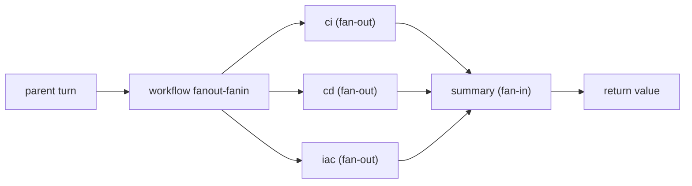

# D4 · Loop / Graph / Automation 证据

生成时间：`2026-11-09T06:35:43+00:00` · dsh `0.2.0-rc.2` · 模型 `d3-minimax` / `MiniMax-M2.7-highspeed`

## 验收结果

| 验收项 | 结果 |
| --- | --- |
| `fanoutRan` | PASS |
| `fanInRan` | PASS |
| `routingExplained` | PASS |
| `partialFailureIsNull` | PASS |
| `fatalStopsWholeRun` | PASS |
| `agentCapEnforced` | PASS |
| `syncTimeoutEnforced` | PASS |
| `goalRoundCapConfigured` | PASS |
| `concurrencyCapped` | PASS |
| `stopConditionConfigured` | PASS |
| `singleWorkflowCallPerRun` | PASS |
| `resultIsPureJson` | PASS |

## 停止条件配置

| 配置 | 值 | 作用 |
| --- | --- | --- |
| `maxConcurrentAgents` | `2` | 本次 fan-out 的并发上限 |
| `maxTotalAgents` | `10` | 单 run 子代理总数天花板（cap 对照覆盖为 2） |
| `maxItemsPerCall` | `8` | 单次 `parallel()`/`pipeline()` 条目上限 |
| `syncTimeoutMs` | `3000` | 脚本同步执行超时 |

## Auto loop · Goal

| 层 | 包 | 职责 | 本 profile |
| --- | --- | --- | --- |
| service | `@deepseek-ai/dsh-goal` | 持久化 goal 状态，不调度工作 | mounted |
| driver | `@deepseek-ai/dsh-goal-round-driver` | 在 active 且续跑 armed 时推进下一轮 | mounted |
| tool | `@deepseek-ai/dsh-tool-goal` | 模型侧 get/create/update 工具 | mounted |
| command | `@deepseek-ai/dsh-command-goal` | `/goal` 用户界面 | mounted |

`defaultMaxGoalRounds: 20` 是自动续跑的退出条件（包默认 256，本 overlay 显式覆盖为 20）。
goal 状态跨 turn / resume / 进程重启持久；但续跑许可（armed）是进程本地的，重启后需要重新 arm。

## 三路 fan-out + fan-in

```json
{
  "count": 3,
  "parts": [
    "CI（持续集成）是指开发者频繁将代码合并到主分支，并通过自动构建和测试流水线及时发现和修复问题的实践。",
    "CD（Continuous Delivery，持续交付）是指将软件随时保持在可发布状态，通过自动化构建、测试与部署流水线，把小批量、高频率的变更安全地推向生产环境的过程。",
    "IaC（基础设施即代码）是用版本控制中的代码来声明和自动管理基础设施配置，从而实现可重复、可审计的环境搭建与变更。"
  ],
  "summary": "CI 通过频繁合并与自动构建测试快速发现问题，CD 借助自动化流水线将小批量高频率变更安全推向生产，IaC 以版本化代码声明并自动管理基础设施，实现环境可重复、可审计，三者共同构成现代 DevOps 的交付基础。"
}
```

路由图：



逐分支事件见 [`routing.md`](routing.md)。

## 失败传播与停止条件对照

| 对照 | 预期 | 观察 | 关键输出 |
| --- | --- | --- | --- |
| `partial` | 普通分支抛错 → 该项为 null，其余完成 | `completed` | `{"results": ["OK1", null, "OK2"]}` |
| `fatal` | 非法 agent 选项 → 整个 run 失败 | `error` | `Error: workflow run failed: WorkflowError: agent() option "bogusOption" is not recognized (supported: label, phase, schema, provider, model)` |
| `cap` | maxTotalAgents=2 时启动第 3 个 agent → AGENT_CAP | `error` | `Error: workflow run failed: WorkflowError: this run reached its total agent cap (2) — a runaway-loop backstop; raise the applicable maxTotalAgents limit if the scale is intentional` |
| `timeout` | syncTimeoutMs=3000 下同步忙等 6 秒 → 脚本超时 | `error` | `Error: workflow run failed: Error: Script execution timed out after 3000ms` |

`partial` 证明普通分支失败只影响该项；`fatal`、`cap`、`timeout` 证明参数/schema 错误和引擎上限会终止整个 run，绝不返回部分成功。

## Session

| 用途 | session |
| --- | --- |
| `fanout` | `session-7812c5e1-8f93-4f67-a02e-ba54379b44b7` |
| `partial` | `session-1234e95a-edfb-4ce1-82c8-a09f455c0148` |
| `fatal` | `session-3f8c5e2d-516b-4075-afb9-55251ba5f6d5` |
| `cap` | `session-6b928ce2-dbd8-4efb-aa83-75d155a83b93` |
| `timeout` | `session-a8795325-ce9c-4feb-a9a0-88b22e635e51` |

## 复现

```bash
git clone -b WCF git@github.com:IQE-SUZHOU/harness-bootcamp.git
cd harness-bootcamp
export PATH=<home>/node/bin:$PATH   # if dsh is installed there
export DSH_PATCH=<model-overlay.yml> # optional: provider/model route
./demos/day4/loop-graph-demo.sh
```

依赖 `dsh`、`zstd`、`python3`。默认产物写入 `d4-artifacts/`（已 gitignore），证据快照写入 `demos/day4/evidence/`。

## 边界

- 所有源码与证据写入都在仓库内。
- 唯一的外部写入是 `dsh` 会话状态 `$DSH_HOME/sessions/`。
- 提交的证据已替换仓库根、home、DSH_HOME 等机器本地路径，并过滤 `sk-` 形式的密钥。
