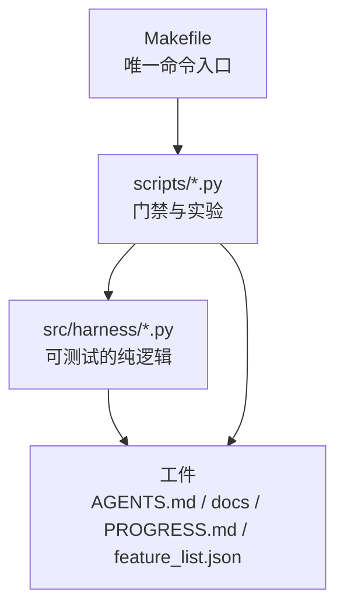

# 架构与模块划分

本仓库没有业务功能，产品就是 harness 本身：工件（Markdown/JSON）+ 门禁（Python 脚本）+ 入口（Makefile）。

## 依赖方向

只允许上层读下层：`src/harness/` 不 import `scripts/`，也不调用 make。
逻辑放 `src/harness/` 才能被 pytest 覆盖；脚本只做编排、打印和退出码。

## 模块职责

| 模块 | 职责 | 对应子系统 |
|------|------|-----------|
| `src/harness/instruction_budget.py` | 入口文件行数与 token 预算、路由表解析、硬约束计数、中部位置风险 | 指令（L02/L04） |
| `src/harness/continuity.py` | `PROGRESS.md` 小节校验、commit 提取、`DECISIONS.md` 解析、交接四字段、重建成本估算 | 状态（L05） |
| `src/harness/feature_list.py` | 功能清单状态机：状态枚举、WIP=1、passing 必须绑定验证命令与证据 | 范围与反馈（L01/L02） |
| `src/harness/run_state.py` | 运行态检查点 schema 校验与续跑决策（next_step / mark_done），纯逻辑不落盘 | 状态（D2/L03） |
| `scripts/check_contract.py` | 把上面三个模块的判断合成一个 rc，外加无密钥与消融残留检查 | 反馈 |
| `scripts/onboarding_quiz.py` | 全新会话测试五问的自动判定 | 指令 + 状态 |
| `scripts/audit_score.py` | 五元组 0-5 打分，输出最低分项 | 全子系统 |
| `scripts/ablate.py` | 消融实验脚手架，移走工件、跑探针、强制恢复 | 实验 |
| `scripts/session.py` | 上班读状态并验证一致性；下班校验交接完备 | 状态 |
| `scripts/state_demo.py` | D2 演示编排：多步流水线原子落盘、模拟 kill -9、重启续跑并断言不重做 | 状态（D2） |

## 不做的事

- 不接 LLM API：本仓库只负责让任何 agent 都能一读就跑，模型在仓库外。
- 不加数据库和外部服务：状态一律是 git 跟踪的文本文件，可 diff、可回滚。
- 不做通用框架：三个模块只服务本仓库的门禁，抽出通用库属于后续讲次。
- 不在 `AGENTS.md` 写实现细节：入口只做路由，见 `docs/instruction-rules.md`。

## 修改约束

改 `src/harness/` 必须同时改 `tests/` 对应用例；只改实现不改测试视为验证缺口。
新增脚本必须出现在 `Makefile` 的某个 target 里，否则 agent 找不到入口，等同不存在。
